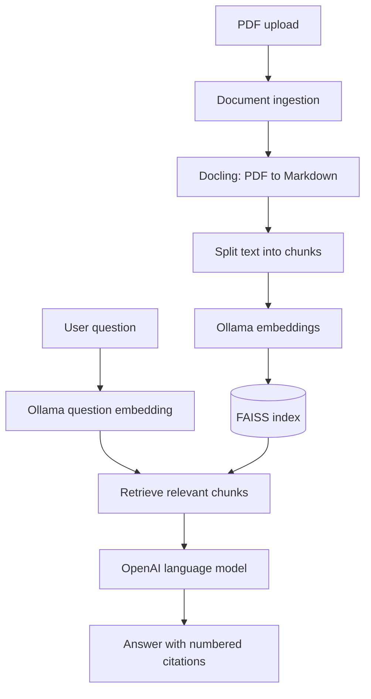

# Ask your PDF
Upload a PDF and ask questions about its contents.

## Architecture

The application uses retrieval-augmented generation (RAG) to answer questions
about uploaded documents.



1. **Ingestion:** `backend/document_processing.py` converts PDFs to Markdown
   with Docling. `backend/vectorstore.py` splits the text into overlapping
   chunks, embeds them with Ollama, and saves them with source filenames in a
   FAISS index.
2. **Questions:** `backend/retrieval.py` embeds the question and retrieves up
   to three relevant chunks using maximal marginal relevance. It sends the
   question and numbered chunks to the OpenAI model, prompting it to answer
   from that context and cite its sources. The interface returns the answer
   and source filenames.
3. **Storage:** Indexes may be temporary or stored persistently in the
   `faiss_index` directory. Model settings are in `backend/config.py`.

## Setup

You need Python 3.10 or newer, Ollama and an OpenAI API key.

```bash
python -m venv .venv
source .venv/bin/activate
pip install -r requirements.txt
ollama pull embeddinggemma-2:440m
```

Start Ollama if it is not already running (`ollama serve`). Add your api key to a
`.env` file in the project root:

```text
OPENAI_API_KEY=your_api_key
```

The `.env` file is ignored by Git. The embedding and language models can be
changed in `backend/config.py`.

## Streamlit app

```bash
streamlit run app.py
```


## API

```bash
uvicorn api:app
```

Open `http://127.0.0.1:8000/docs` for interactive API documentation.

```bash
# Check the API
curl http://127.0.0.1:8000/health

# Add a PDF to the vector store
curl -X POST http://127.0.0.1:8000/upload -F "file=@/path/to/document.pdf"

# Ask a question
curl -X POST http://127.0.0.1:8000/ask \
  -H "Content-Type: application/json" \
  -d '{"question": "What is this document about?"}'
```

The API keeps a shared index in `faiss_index`. Uploads append to it, including
duplicate uploads. Run one API worker and avoid modifying the index from another
process while the API is running. 
